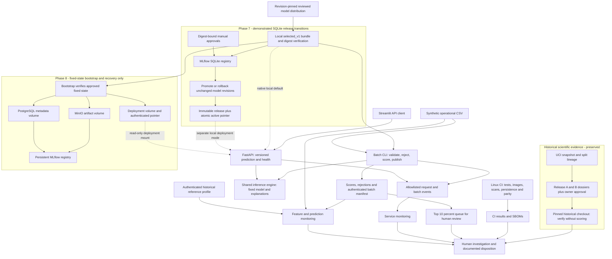
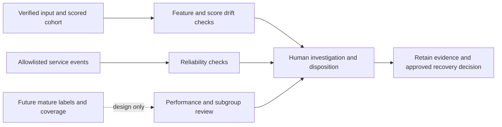

# Implemented local architecture

**Status:** Week 11 communication candidate. The arrows below describe existing
code and frozen evidence, not an expanded release or cloud deployment.

## Component-to-implementation map

| Concern | Implemented authority | Boundary |
| --- | --- | --- |
| Historical science and approval | [Release A dossier](../../reports/releases/release_a_v1/release-a-report.md), [Release B approval](../../configs/releases/release_b_owner_approval_v1.json), [historical verifier](../../.github/workflows/release-b-evidence.yml) | Verify the original checkout with fixed digest anchors; later source changes are tested separately. |
| Model distribution | [Artifact workflow](../../src/credit_risk/artifact_distribution/workflow.py), [model manifest](../../models/selected_v1/manifest.json) | Distribution supplies exact bytes; it neither promotes a model nor gives runtime loaders network access. |
| Inference and batch policy | [Shared engine](../../src/credit_risk/inference/engine.py), [batch workflow](../../src/credit_risk/inference/batch.py), [frozen contract](../../configs/inference/phase6_v1.json) | Fixed predictors, identity calibration, risk bands and review policy. API has no portfolio ranking context. |
| API and UI | [API application](../../src/credit_risk/inference/api.py), [Streamlit client](../../app.py) | Native Windows processes for the live walkthrough; containers are independently exercised on Linux. |
| Phase 7 transitions | [Registry workflow](../../src/credit_risk/registry/workflow.py), [approved registry evidence](../../reports/registry/phase7_v1/registry-release-report.md) | SQLite demonstrates promotion and rollback between revisions of identical model bytes. |
| Phase 8 persistence | [Compose stack](../../docker-compose.platform.yml), [bootstrap](../../src/credit_risk/platform/bootstrap.py), [platform protocol](../platform/phase8-protocol.md) | PostgreSQL, MinIO and deployment volumes support fixed-state bootstrap, verification and restart recovery. No PostgreSQL promotion/rollback claim. |
| Monitoring and incidents | [Monitoring workflow](../../src/credit_risk/monitoring/workflow.py), [incident runner](../../src/credit_risk/incidents/workflow.py), [runbooks](../operations/release-b-runbooks.md) | Alerts prompt investigation; no automatic retraining, threshold change or promotion. |
| Delivery controls | [Linux CI](../../.github/workflows/ci.yml), [source storage guide](../artifacts/storage-architecture.md) | Existing tests, branch coverage, image scans and SBOMs; row-level data and runtime credentials stay outside Git. |

The two registry subgraphs are separate demonstrations. There is no migration or
runtime transition arrow between their databases. The native demo reads the
verified local bundle; it does not pretend that local Windows services reproduce
the full Docker stack. The API/UI and batch scores are technical demonstrations,
not lending approval, causal explanations or autonomous customer decisions.

## Engineering decisions and practical limits

| Decision | Why it fits this product | Cost / when to reconsider |
| --- | --- | --- |
| Batch-first monthly scoring | Matches billing cadence and fixed portfolio capacity; supports completeness, duplicate rejection, reconciliation and safe retries. | Requires a complete snapshot. Revisit only with a demonstrated shorter decision deadline or event-level requirement. [ADR 0001](../adr/0001-batch-first-scoring.md). |
| Secondary API, API-only UI | Supplies an integration/demo contract and health/readiness checks. The UI cannot diverge by loading its own estimator. | A single score cannot determine portfolio queue membership; UI checks do not establish service capacity or operational eligibility. |
| One inference engine | Keeps feature order, probability, bands, explanations and model identity consistent across interfaces. | Shared defects can affect every interface; parity tests need independent contract fixtures and artifact-integrity checks. [Parity evidence](../../reports/inference/phase6_v1/inference-parity-report.md). |
| Content-addressed bytes and immutable deployment revisions | Exact identity supports verification, no-rewrite reuse and traceable recovery. Pinned distribution separates retrieval from offline loading. | Checksums establish byte integrity against trusted anchors, not model quality, approval or protection from compromise of the trust source. [Storage guide](../artifacts/storage-architecture.md). |
| Manual registry transitions and fixed-state bootstrap | Demonstrates approval, compensated alias changes, atomic activation and persistent reconstruction in bounded local scenarios. | SQLite transitions and PostgreSQL bootstrap are different workflows. No multi-node release consensus, PostgreSQL transition support or superiority of a new model is demonstrated. |
| Strict row rejection with partial batch publication | Preserves valid rows and explicit rejections; a published partial run exits 3 for the caller to handle. | Callers must reconcile coverage before use; quality rejection cannot silently become eligibility approval. |
| Local files, volumes and small tabular tools | Sufficient for this historical dataset and an inspectable single-machine demonstration. | In-memory batch processing/ranking and SHAP, local disk, a single service host and process-local state limit scale. Synthetic counts and benchmark evidence are not a maximum-throughput guarantee. |

No new runtime defect was established by the portfolio audit, so this enhancement
changes explanations and operating guidance rather than rewriting working
inference, registry or deployment code. Dependency overrides, non-root images,
allowlisted logs, local service binding, scans and SBOMs are implemented controls;
they do not establish current vulnerability freedom, regulatory compliance or a
complete production security program.

## Human monitoring and feedback boundary

The [delayed-label contract](../operations/delayed-label-contract.md) is a future
data design; UCI supplies no operational longitudinal feed. Drift is observable
before outcomes and is not a performance estimate. Investigation never initiates
training, changes thresholds or promotes a model automatically. Existing
[incident runbooks](../operations/release-b-runbooks.md) distinguish data rejection,
drift, artifact failure, service interruption and SQLite rollback.

## What production or cloud deployment would require

Before scaling, measure representative batch size, peak request rate, SHAP cost,
memory, latency and the completion deadline with approved synthetic workloads.
Then choose bounded concurrency, scheduling, partitioning and resource limits
while retaining global deterministic ranking, unique run identity and atomic
publication. Horizontal replicas would need tested activation coordination;
local atomic file operations do not imply distributed transactions.

A future cloud design would add organization-owned identity/authorization,
secrets and key rotation, encrypted ingress, network isolation, data access and
retention controls, centralized telemetry, backup/restore objectives, scheduling,
on-call ownership and approved incident recovery. Representative data, mature
labels and model-risk approval remain separate prerequisites. PostgreSQL
promotion/rollback would need its own concurrency, compensation and failure
evidence. None is supplied by renaming a local component after a cloud service.

## Conceptual cloud mapping

| Local component | Conceptual Azure/Databricks analogue |
| --- | --- |
| Python batch task | Databricks Jobs / Workflows |
| Local files and MinIO | ADLS Gen2 and Delta tables |
| MLflow tracking and aliases | Managed MLflow and Unity Catalog models |
| FastAPI container | Azure Container Apps or managed serving |
| CLI reports and safe events | Lakehouse Monitoring / Azure Monitor patterns |

These are interview mappings only. No Azure resources, Spark pipeline, cloud
model registry or managed monitoring deployment is implemented by this project.
